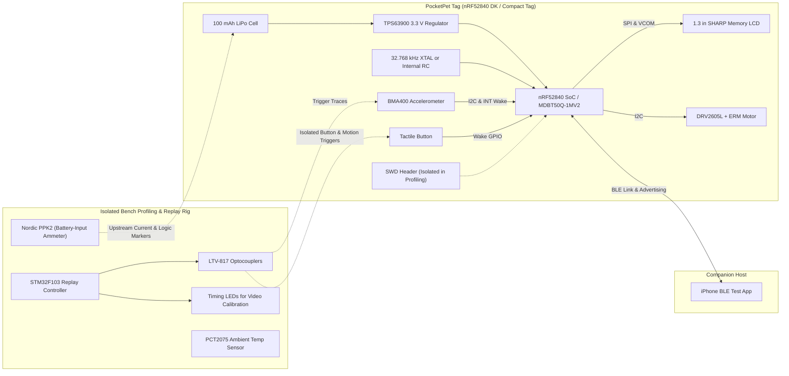

# System & Measurement Architecture

> **Status: Planned engineering baseline.** This document summarizes the target PocketPet tag architecture and bench profiling rig prior to hardware bring-up and formal measurements.

## Block Diagram

## Research & Co-Design Structure (RQ1–RQ4)

1. **RQ1 — Motion Sensing vs. Unintended Wakes:**
   - Capture real physical desk idle, graded bag-carry, and deliberate-pickup traces on battery power to observe missed pickups, unnecessary wakes/hour, and interrupt timestamps.
   - Keep the `BMA400` powered in active sensing mode on the bench and replay recorded wake schedules plus wake-rate sweeps via optocoupler triggers to identify the break-even wake rate where unwanted wakes erase periodic-polling savings.
2. **RQ2 — LF Clock Source & BLE Connection Interval:**
   - On the same `nRF52840` board, compare an external 32.768 kHz crystal (`ABS07-32.768KHZ-9-T`) against a calibrated internal RC oscillator across two phone-accepted connection intervals while holding peripheral latency and TX power fixed.
   - Evaluate whether clock selection alters the charge saved by extending the connection interval.
3. **RQ3 — Advertising Schedule & Link Recovery:**
   - Lock the phone during matched separations while keeping clock source, TX power, and initial advertising rate fixed.
   - Compare fixed-rate vs. fast-then-slow advertising with phone returns occurring both before and after the rate switch; log charge apart, time to link restoration, and timeouts.
4. **RQ4 — Resting Display Retention & Routine Transfer Batching:**
   - Evaluate resting-image retention and batched routine radio transfers individually and combined across matched command schedules.
   - Require identical animations, haptics, and state-freshness guarantees across configurations, prioritizing button presses and nearby find commands.

## Engineering Targets & Validation Plan

| Metric | Target / Definition | Validation Method |
| --- | --- | --- |
| **Daily Power Budget** | Nominal ~1.67 mAh/day (69.4 µA avg on 100 mAh for 60 days); prototype budget = measured usable capacity at cutoff / 60 days | Compare modeled daily charge against a continuous 24-hour mixed-use PPK2 capture; verify separately via timed full-to-cutoff discharge |
| **Button Response** | Visible LCD frame change ≤ 150 ms for ≥ 95% of presses | High-frame-rate video capturing physical button contact and first changed display frame |
| **Nearby Find Response** | Physical ERM vibration ≤ 2 s for ≥ 95% of requests on an established link | Foreground trials at 1 m, 5 m, 10 m (line-of-sight and in-bag); video marker calibrated against motor onset |
| **Statistical Comparison** | ≥ 10 randomized matched baseline–candidate pairs per condition | Within-pair charge differences and response rates with 95% bootstrap confidence intervals; timeouts counted as failures |

See [../README.md](../README.md) and [../AGENTS.md](../AGENTS.md) for repository status, team ownership, and data hygiene standards.
